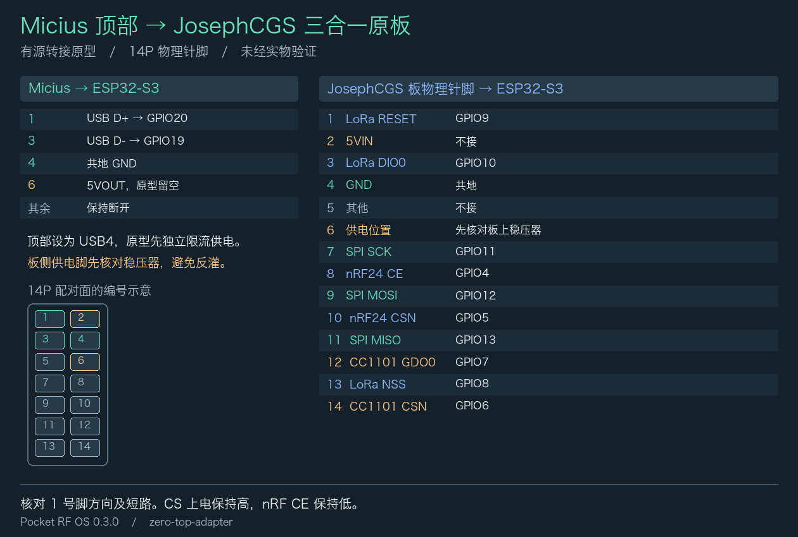

# JosephCGS 三合一原板 → CardputerZero 转接

**推荐方案是有源转接板。** 原射频 PCB 保持原样，插到转接板的 14P 母座。转接板从 Micius 顶部走 USB4，ESP32-S3 独立控制三个收发器、共享 SPI 和片选。0.3.0 提供独立固件型谱 `zero-top-adapter`。这是可制作的原型接线定义和可编译固件，当前没有实物转接板数据来验证电源、连通性和射频表现。

## Micius → 有源转接板

| Micius 顶部物理针脚 | 连接到 ESP32-S3 转接板 | 说明 |
| ---: | --- | --- |
| 1 | USB D+（ESP32-S3 GPIO20） | 顶部接口须切到 USB4。差分对按 ESP32-S3 官方 USB 布线。 |
| 3 | USB D−（ESP32-S3 GPIO19） | 与 D+ 并行、短且等长，共地。 |
| 4 | GND | Micius、转接板和射频板共地。 |
| 6 | 5VOUT，原型起始保持断开 | 首次使用独立、限流电源。确认 Zero 输出规格、负载与瞬态后才评估用顶部供电，避免反灌。 |
| 2、5、7–14 | 不接 | 5VIN、系统 I²C、主机 SPI、UART 及其余信号不需要参与这个方案。 |

## ESP32-S3 转接板 → JosephCGS 板

面向接口针脚编号读表，不要按连接器背面的镜像位置焊接。所有射频数字信号为 3.3 V 逻辑。板侧 14P 的实际丝印和连通关系请在断电下确认。

| JosephCGS 板物理针脚 | 信号 | 原 ADV GPIO | 新 ESP32-S3 GPIO |
| ---: | --- | --- | ---: |
| 1 | LoRa RESET | G3 | 9 |
| 2 | 5VIN 位置 | — | 不接 |
| 3 | LoRa DIO0 | G4 | 10 |
| 4 | GND | — | GND |
| 5 | 未在三射频配置使用 | G6 | 不接 |
| 6 | 主机 5VOUT 位置 | — | 确认走到板上稳压器 VIN 后才供电 |
| 7 | SPI SCK | G40 | 11 |
| 8 | nRF24 CE | G8 | 4 |
| 9 | SPI MOSI | G14 | 12 |
| 10 | nRF24 CSN | G9 | 5 |
| 11 | SPI MISO | G39 | 13 |
| 12 | CC1101 GDO0 | G13 | 7 |
| 13 | LoRa NSS | G5 | 8 |
| 14 | CC1101 CSN | G15 | 6 |

- **CC1101** 的片选和 GDO0 各占一线，现有 TX 实现轮询 SPI 状态，无需 GDO2。
- **nRF24L01** 的 CE 和 CSN 都移到转接板，不与 Micius 的 I²C 相连。上电默认状态需要 CE 低、所有 CS 高。
- **LoRa** 按仓库的 DIO0 型接法适配 SX127x。上电前核对射频板丝印和工作频段，SX1262 需要 BUSY/DIO1 的另一套电路。
- 该方案定义三块射频芯片。扩展板若另装 W5500，先按实物确认其片选位置已保持高电平，避免共享 MISO 争用。文档没有 PCB 网表，供电和附加芯片属于实物验收项。

## 无源转接板能不能做

理论上可以重新分配顶部控制线。为避免系统 I²C，候选映射如下。它需要新的 Linux SPI 片选配置和射频驱动，**未在本版启用**。

| JosephCGS 侧 | Zero 侧候选 |
| --- | --- |
| SPI：7 / 9 / 11 | 7 / 9 / 11 直通 |
| nRF24 CE：8 | 5 / G22 |
| nRF24 CSN：10 | 1 / G26，保持顶部 GPIO 模式 |
| CC1101 CSN：14 | 3 / G23，保持顶部 GPIO 模式 |
| CC1101 GDO0：12 | 12 / G15，须释放 UART |
| LoRa RESET：1 | 14 / G14，须释放 UART |
| LoRa NSS：13 | 13 / G7 |
| LoRa DIO0：3 | 留空，新的驱动须轮询 LoRa IRQ 寄存器 |

Micius 当前只导出 `/dev/spidev0.1`，同一 SPI0 还连内置屏幕。额外片选需要受内核 SPI 控制器统一仲裁。用用户态 GPIO 拉低片选再执行 SPI 传输，中间存在屏幕事务插入的风险。

## 首次上电核对

1. 关机，脱开 Micius 和原板，逐针确认母座编号方向、GND、供电入口和片选分离。
2. 用独立限流电源验证供电。先在转接控制板自己的原生 USB 口刷入 `zero-top-adapter` 的 bootstrap 镜像，启动后通过串口确认型谱。
3. 关机后接入顶部。系统切到顶部 USB4，再在 Pocket RF OS 主页按 **3 → R → B**。只有读到适配器型谱才进入三模块界面。用原始 0.3.0 固件和发布校验和核对所刷镜像。
4. 按 CC1101、nRF24、LoRa 顺序做芯片检测和只读扫描。最后用匹配天线、频段和第二台兼容设备验收点对点消息。

[JosephCGS 原配置](https://github.com/JosephCGS/Cardputer-ADV-CC1101-NRF24L01-LoRa/blob/main/README.md) · [ADV 针脚](https://docs.m5stack.com/en/core/Cardputer-Adv#ext-254-14p) · [Zero 顶部针脚](https://docs.m5stack.com/en/CardputerZero#ext-254-14p) · [ESP32-S3 电气指南](https://docs.espressif.com/projects/esp-hardware-design-guidelines/en/latest/esp32s3/schematic-checklist.html) · [Linux SPI 用户空间](https://docs.kernel.org/spi/spidev.html)
